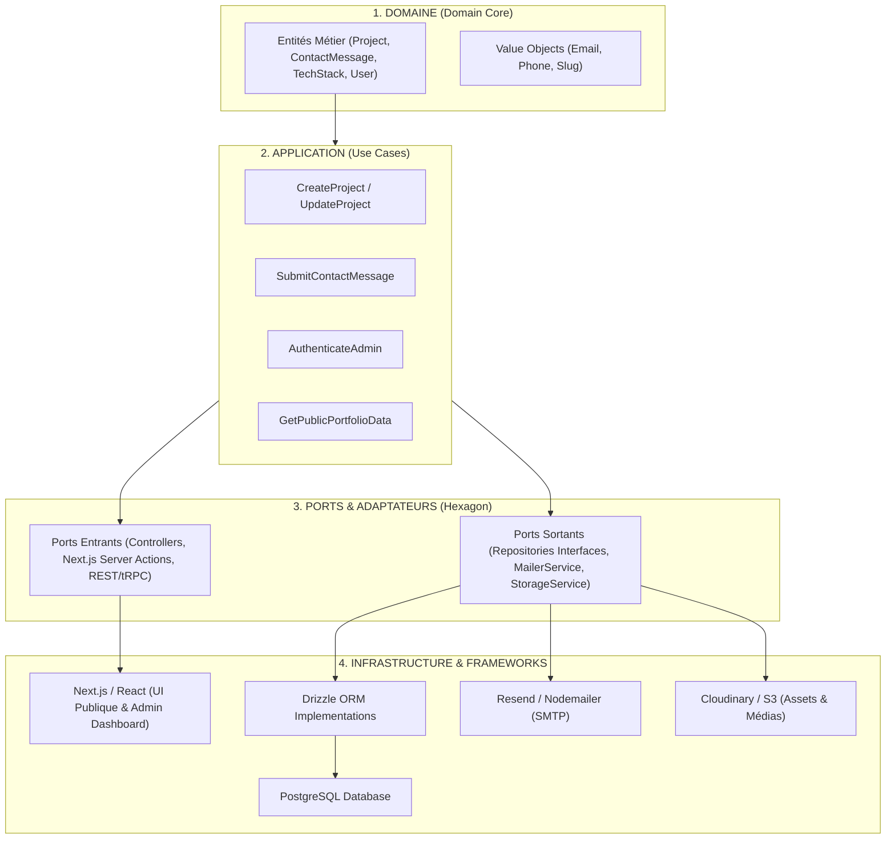
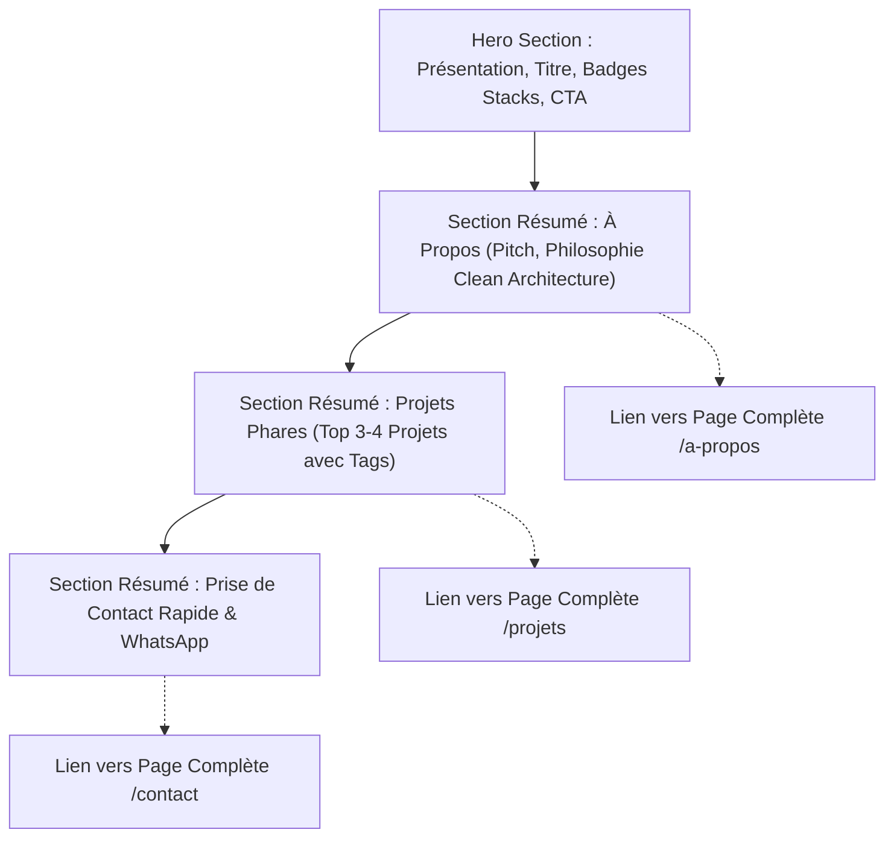
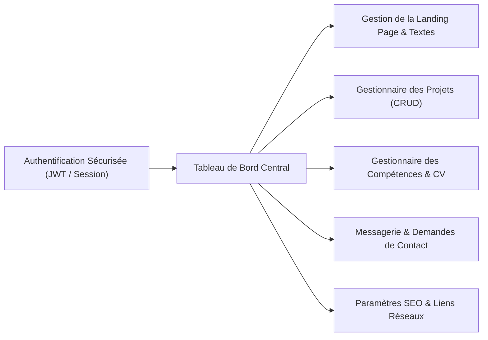
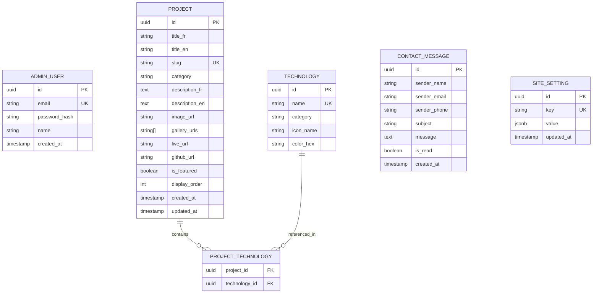

# CAHIER DES CHARGES FONCTIONNEL ET TECHNIQUE
## PROJET : PORTFOLIO PROFESSIONNEL & CMS ADMINISTRATIF PRIVÉ
**Auteur & Titulaire :** BAUTZEN FOYET LAIRRY VALLONE  
**Rôle :** Développeur Web & Mobile Fullstack  
**Date :** Octobre 2026 | Version : 1.0 (Validée)

---

## 1. FICHE D'IDENTITÉ & CONTEXTE DU PROJET

### 1.1 Présentation du Profil
* **Nom complet :** BAUTZEN FOYET LAIRRY VALLONE
* **Intitulé du poste :** Développeur Fullstack Web & Mobile
* **Spécialités d'ingénierie :** Clean Architecture, Architecture Hexagonale (Ports & Adapters), APIs robustes, Applications scalables et réactives.
* **Localisation :** Bafoussam, Cameroun (Disponible en télétravail local & international / Remote).
* **Contact Téléphonique :** +237 697 480 153 / +237 654 399 609
* **Courriel professionnel :** [bautzennfoyettcbs@gmail.com](mailto:bautzennfoyettcbs@gmail.com)
* **Particularité linguistique :** 100% Bilingue (Français & Anglais).

### 1.2 Vision et Enjeux
Le projet consiste en la conception et le déploiement d'une plateforme web haut de gamme à double volet :
1. **Un portail public moderne et ultra-performant :** Vitrine professionnelle présentant l'expertise technique, les réalisations majeures et facilitant la prise de contact pour des missions en freelance, du consulting ou des opportunités en entreprise.
2. **Une plateforme d'administration privée (Back-Office / CMS sur-mesure) :** Interface sécurisée permettant à Bautzen de piloter 100% des contenus du site public sans toucher au code source (textes, projets, technologies, téléchargements de CV, gestion des messages entrants).

### 1.3 Cibles Utilisateurs
* **Recruteurs & Responsables RH (Tech Talent Acquisition) :** Recherchent une vue synthétique, des preuves de compétences, un CV téléchargeable et la confirmation du niveau bilingue.
* **Clients & Entreprises (B2B / Freelance) :** Recherchent un développeur autonome, capable de concevoir des architectures pérennes (Clean/Hexagonale), des applications web/mobiles et des sites vitrines à forte conversion.
* **Communauté Tech & Pairs :** Évaluent la qualité du code, l'élégance architecturale et la maîtrise des technologies modernes.

---

## 2. CHARTE GRAPHIQUE & EXPÉRIENCE UTILISATEUR (UI/UX)

### 2.1 Palette de Couleurs Officielles
L'harmonie chromatique allie rigueur technique, dynamisme et clarté :

| Rôle de la Couleur | Teinte & Code Hexadécimal | Signification & Application |
| :--- | :--- | :--- |
| **Bleu Principal (Dominante)** | `#0F172A` (Bleu Nuit) / `#1E40AF` (Bleu Royal) | Représente la solidité technique, la rigueur logicielle, la confiance et la profondeur. Utilisé pour les fonds sombres, les en-têtes et les cartes techniques. |
| **Orange Énergique (Accent)** | `#FF6B00` / `#F97316` (Orange Vif & Ambré) | Symbolise la créativité, l'innovation, le dynamisme et l'action. Utilisé pour les Call-To-Action (CTA), badges, surlignages et liens actifs. |
| **Blanc & Gris Neutre (Clarté)** | `#FFFFFF` (Blanc Pur) / `#F8FAFC` (Blanc Crème) | Apporte l'aération, la lisibilité typographique, les contrastes et les bordures élégantes. |
| **Couleurs de Statut** | Succès `#10B981`, Erreur `#EF4444`, Warning `#F59E0B` | Indicateurs pour l'administration et les retours formulaires. |

### 2.2 Direction Artistique & Inspirations Visuelles
* **Cartes biseautées et arrondis ergonomiques :** Inspiré des visuels modernes de présentation professionnelle (comme la structure carte d'identité visuelle avec bordures arrondies douces `rounded-3xl`, badges flottants et micro-ombres douces).
* **Glassmorphism subtil & Accents néon discrets :** Arrière-plans avec effet de flou (`backdrop-blur-md`), bordures fines lumineuses (`border border-blue-500/20`).
* **Micro-interactions & Animations fluides :** Transitions au survol (hover scale, lueurs orangées), chargement dynamique des sections via *Framer Motion*.
* **Responsive First :** Expérience utilisateur fluide adaptée de l'écran mobile 360px jusqu'au grand écran 4K.

---

## 3. ARCHITECTURE LOGICIELLE ET CHOIX TECHNIQUES

Le projet valorise la rigueur d'ingénierie appliquée par Bautzen : **Clean Architecture & Architecture Hexagonale**.

### 3.1 Stack Technologique Recommandée

* **Frontend & Rendu Public / Admin :**
  * **Framework :** Next.js 14+ (App Router) avec React.js et TypeScript strict.
  * **Styling :** Tailwind CSS avec configuration personnalisée des tokens Orange/Bleu/Blanc.
  * **Composants & Primitives :** Radix UI / Shadcn UI (accessible, customisable).
  * **Gestion d'état & Animations :** Zustand ou React Query, Framer Motion.
* **Backend & API :**
  * Solution 1 (Monorepo unifié) : Next.js Server Actions & Route Handlers typés.
  * Solution 2 (API Dédiée) : NestJS ou AdonisJS (TypeScript, architecture modulaire robuste avec contrôleurs, services, guards d'authentification).
  * Complément Python : Scripts de traitement de données ou microservices si besoin.
* **Base de Données & ORM :**
  * **Moteur de BDD :** PostgreSQL (Supabase, Neon ou instance dédiée).
  * **ORM :** Drizzle ORM (type-safe, ultra-rapide, contrôle fin du SQL).
  * **Migrations :** Drizzle Kit.
* **Internationalisation (i18n) :**
  * `next-intl` pour un basculement instantané Français / Anglais sans perte de référencement (SEO multilingue `/fr` et `/en`).

---

## 4. SPÉCIFICATIONS FONCTIONNELLES DÉTAILLÉES

### 4.1 Plateforme Publique (Vitrine Utilisateur)

#### 4.1.1 En-tête (Navbar) & Footer Global
* **Barre de Navigation Flottante :**
  * Logo / Monogramme dynamique : "BF" (Bautzen Foyet) avec lueur orange.
  * Liens de navigation : Accueil, À Propos, Projets, Contact.
  * Sélecteur de langue : Bouton bascule instantané (FR / EN).
  * Bouton CTA rapide : "Me contacter" ou "Télécharger CV".
* **Pied de Page (Footer) :**
  * Coordonnées complètes (+237 697480153 / +237 654399609, Bafoussam, Cameroun).
  * Liens réseaux professionnels (GitHub, LinkedIn, Twitter/X, WhatsApp).
  * Lien discret d'accès à l'administration (`/admin/login`).

#### 4.1.2 Page d'Accueil (Landing Page)
La Landing Page est conçue comme un condensé percutant menant vers les pages détaillées :

1. **Hero Section :**
   * Phrase d'accroche valorisant l'expertise : Développeur Web & Mobile Fullstack bilingue.
   * Badges technologiques interactifs : React, Next.js, TypeScript, Tailwind, AdonisJS, NestJS, Python, PostgreSQL, Drizzle ORM.
   * Carte visuelle moderne avec photo professionnelle de Bautzen (effet biseauté haut de gamme).
   * Double CTA : "Découvrir mes projets" (bouton orange) et "Télécharger mon CV" (bouton contour bleu).
2. **Résumé "À Propos" :**
   * Présentation courte (parcours, vision de la Clean Architecture & Hexagonale).
   * Indicateurs clés (Années d'expérience, projets livrés, satisfaction client).
   * Lien interactif : *"En savoir plus sur mon parcours →"* (redirection vers `/a-propos`).
3. **Résumé "Mes Projets" :**
   * Grille présentant 3 à 4 projets phares (Web complexe, Mobile, Site vitrine).
   * Tags de technologies utilisées sur chaque carte.
   * Lien interactif : *"Voir tous mes projets (avec filtres) →"* (redirection vers `/projets`).
4. **Résumé "Contact & Disponibilité" :**
   * Statut de disponibilité : "Disponible pour nouveaux projets / Recrutement".
   * Bouton rapide "Discuter sur WhatsApp" (accès direct au +237 697480153).
   * Lien interactif : *"Accéder au formulaire de contact complet →"* (redirection vers `/contact`).

#### 4.1.3 Page Dédiée "À Propos" (`/a-propos`)
* **Biographie Complète & Philosophie d'Ingénierie :** Explication vulgarisée de l'approche Hexagonale / Clean Architecture appliquée au web et mobile pour garantir robustesse et testabilité.
* **Matrice des Compétences :**
  * *Frontend & Mobile :* React.js, Next.js, React Native, TypeScript, Tailwind CSS.
  * *Backend & API :* AdonisJS, NestJS, Node.js, Python.
  * *Base de Données & Architecture :* PostgreSQL, Drizzle ORM, Clean Architecture, Hexagonal Pattern, Modélisation SQL.
* **Parcours Académique & Expériences :** Timeline chronologique interactive.
* **Téléchargement du CV :** Fichiers PDF disponibles en Français et en Anglais.

#### 4.1.4 Page Dédiée "Mes Projets" (`/projets`)
* **Système de Filtres par Catégorie :**
  * Tout / Applications Web / Applications Mobiles / Sites Vitrines / APIs & Backends.
  * Filtre par technologie (ex: Next.js, AdonisJS, Python, PostgreSQL).
* **Fiche Projet Enrichie :**
  * Image de couverture ou vidéo démo.
  * Titre, description détaillée du problème résolu et de la solution architecturale.
  * Liste des technologies sous forme de badges stylisés.
  * Liens externes : Bouton "Démo en direct" (Live preview) et "Code source GitHub" (si public).

#### 4.1.5 Page Dédiée "Contact" (`/contact`)
* **Formulaire de Contact Sécurisé :**
  * Champs : Nom complet, Adresse email, Numéro de téléphone (optionnel), Sujet, Message.
  * Validation stricte côté client & serveur via *Zod*.
  * Protection antispam (Honeypot + Captcha discret ou Rate Limiting).
  * Accusé de réception automatique par email envoyé à l'expéditeur et notification immédiate à Bautzen.
* **Canaux Directs :**
  * WhatsApp direct (un clic ouvre la discussion pré-remplie).
  * Appels téléphoniques : +237 697480153 / +237 654399609.
  * Email cliquable : `bautzennfoyettcbs@gmail.com`.
  * Localisation : Bafoussam, Ouest, Cameroun avec carte stylisée aux couleurs du site.

---

### 4.2 Plateforme Administrative (Back-Office / CMS Privé)

L'espace administratif est accessible via une route protégée (`/admin`). Il confère à Bautzen un contrôle absolu sur son écosystème web.

#### 4.2.1 Sécurité & Authentification
* Formulaire de connexion administrateur (Email / Mot de passe hashé avec Argon2 ou Bcrypt).
* Authentification avec jetons sécurisés (HttpOnly Cookie, JWT) avec expiration et renouvellement.
* Protection contre les attaques par force brute (verrouillage temporaire après 5 tentatives échouées).

#### 4.2.2 Module "Tableau de Bord" (Dashboard Overview)
* Indicateurs rapides : Total des projets publiés, Nombre de messages reçus, Nouveaux messages non lus, Nombre de téléchargements du CV.
* Liste des derniers messages reçus avec statut (Non lu, Répondu, Archivé).

#### 4.2.3 Module "Gestion du Contenu Public" (CMS Page & Textes)
* Modification en temps réel des textes de la Landing Page :
  * Phrase d'accroche du Hero, titre et sous-titre.
  * Description de la section "À Propos".
  * Sélection des 3 projets mis en avant sur la page d'accueil (featured projects).
  * Modification des numéros de téléphone, adresse email et localisation.
  * Gestion bilingue : Chaque champ texte dispose de son onglet Français et Anglais.

#### 4.2.4 Module "Gestion des Projets" (CRUD Complet)
* **Créer un nouveau projet :**
  * Titre (FR & EN), Slug unique généré automatiquement.
  * Type de projet (Web App, Mobile App, Site Vitrine, Backend API).
  * Description courte et description longue (éditeur de texte riche ou Markdown).
  * Sélection multiple des technologies (badges).
  * Upload d'images (Image principale, galerie de captures d'écran).
  * Liens (Lien du projet en production, lien GitHub).
  * Case à cocher : *Mettre en avant sur la Landing Page (Featured)*.
* **Modifier / Supprimer / Réordonner :** Drag & drop pour organiser l'ordre d'affichage sur le site public.

#### 4.2.5 Module "Boîte de Réception & Contacts"
* Visualisation de tous les formulaires soumis par les visiteurs.
* Affichage du détail : Nom, email, téléphone, date, contenu du message.
* Actions : Marquer comme lu, Répondre par email en 1 clic (`mailto:`), Supprimer ou Archiver.

#### 4.2.6 Module "Paramètres & Fichiers"
* Téléversement et remplacement des fichiers de CV (PDF Français et PDF Anglais).
* Mise à jour des liens vers les réseaux sociaux (GitHub, LinkedIn, X, WhatsApp).
* Configuration des balises de référencement (Meta Title, Meta Description, Image OpenGraph pour les partages WhatsApp/LinkedIn).

---

## 5. MODÈLE DE DONNÉES (POSTGRESQL & DRIZZLE ORM)

### 5.1 Schéma Relationnel des Tables

### 5.2 Définition des Tables avec Drizzle ORM (Exemple Typescript)
* **`projects` :** Stocke les métadonnées bilingues des réalisations, drapeaux "featured", URLs et captures.
* **`technologies` :** Répertoire des langages et frameworks (React, Next.js, AdonisJS, NestJS, Python, Drizzle, etc.).
* **`contact_messages` :** Historique des leads et prises de contact avec statut de lecture.
* **`site_settings` :** Stockage JSON flexible pour les textes dynamiques de la Landing Page, CVs et liens sociaux.

---

## 6. EXIGENCES NON FONCTIONNELLES & CONFORMITÉ

### 6.1 Performance & Core Web Vitals
* Temps de chargement initial inférieur à 1.5 seconde sur réseau 4G.
* Optimisation automatique des images au format WebP/AVIF via `next/image`.
* Score Google Lighthouse ciblé : **> 95/100** en Performance, Accessibilité, Bonnes Pratiques et SEO.

### 6.2 Sécurité Applicative
* Protection contre les injections SQL grâce aux requêtes paramétrées de Drizzle ORM.
* En-têtes HTTP sécurisés (CSP, HSTS, X-Content-Type-Options, X-Frame-Options).
* Chiffrement des sessions administrateur et hachage fort des mots de passe.
* Sanitization des entrées HTML pour éviter toute attaque XSS.

### 6.3 Référencement (SEO) & Partage Social
* Balises sémantiques HTML5 strictes (`<header>`, `<main>`, `<section>`, `<article>`, `<nav>`, `<footer>`).
* Métadonnées dynamiques OpenGraph & Twitter Cards adaptées au bilinguisme.
* Données structurées Schema.org (`Person`, `WebSite`, `SoftwareApplication`) pour maximiser la visibilité sur Google.

---

## 7. FEUILLE DE ROUTE & PHASAGE DU PROJET

| Phase | Intitulé des Travaux | Durée Estimée | Livrables Clés |
| :--- | :--- | :--- | :--- |
| **Phase 1** | **Initialisation & Architecture** | 3 - 5 jours | Configuration du projet Next.js/TypeScript/Tailwind, schémas Drizzle ORM, BDD PostgreSQL, structure Clean Architecture. |
| **Phase 2** | **Design System & Frontend Public** | 5 - 7 jours | Landing page (Hero, résumés), pages À Propos, Projets et Contact. Thème Orange-Bleu-Blanc, animations et responsive. |
| **Phase 3** | **Module d'Administration (CMS)** | 5 - 7 jours | Authentification admin sécurisée, CRUD Projets, gestionnaire de contenus, boîte de messagerie. |
| **Phase 4** | **Internationalisation & Intégrations** | 2 - 3 jours | Configuration bilingue FR/EN, intégration de l'envoi d'emails (Resend/Nodemailer), validation formulaires. |
| **Phase 5** | **Tests, SEO & Déploiement** | 2 - 3 jours | Audit Lighthouse, tests cross-device, configuration domaine personnalisé et CI/CD (Vercel/Railway/VPS). |

---

## 8. VALIDATION DU CAHIER DES CHARGES

Le présent document sert de référence contractuelle et technique pour le développement du portfolio et du CMS de **BAUTZEN FOYET LAIRRY VALLONE**.

* **Statut :** Prêt pour la phase de prototypage & implémentation.
* **Prochaine étape :** Mise en place de l'arborescence du projet et initialisation du socle Clean Architecture.

